# ShadowCI

[](https://github.com/tenalisriharsha/shadowci/actions/workflows/ci.yml)

ShadowCI is an ambient coding agent that watches your code while you work
and prepares verified bug fixes without ever touching your working tree.

It watches file saves, mirrors your uncommitted changes into a shadow git
worktree, and waits until a change set is actually complete — debounced,
idle, and syntactically valid — before doing anything with it. Deterministic
checks run first, for free: a targeted test run when a changed file maps to
a specific test, falling back to the full suite otherwise, plus a type
checker and a linter (both skipped harmlessly if not installed). An LLM is
only called once one of those checks actually fails — and when it does,
ShadowCI asks it to write a regression test and propose a fix.

LLM access is pluggable — a scripted deterministic policy for tests and CI,
headless `claude -p`, or a local model server (Ollama-compatible) — so the
whole system runs and is fully testable with no paid API key. When a check
fails, ShadowCI writes a regression test, applies a proposed fix, and
re-runs the full suite — all inside the shadow worktree. Only once that's
verified does it save a "ghost patch": a diff you can apply to your real
files in one command, `shadowci apply-ghost`, which rebases cleanly onto
whatever you've edited in the meantime instead of clobbering it.

`shadowci ghosts` lists every saved ghost patch — its short name, summary,
the files it touches, and whether it's still `ready` to apply or has gone
`stale` because the live tree moved on — so you never have to go hunting
for a patch's hex filename in scrollback or a file explorer. `ghosts
--clean` discards the stale ones without recording any signal, and
`apply-ghost`, `reject-ghost`, and `ignore-ghost` each take a `--latest`
flag that acts on the newest ready patch instead of needing the filename
spelled out.

Every verified patch also feeds an interruption policy: `apply-ghost`,
`reject-ghost`, and `ignore-ghost` each record what you actually did with a
fix, grouped by the kind of check that originally failed *and* how the
failure was classified (issue #38) — whether the edited code is what the
failing test covers, whether that test passed at `HEAD`, or whether the
user edited the test itself — so a rejected "this looked like a revert"
patch never drags down the score of an unrelated, unambiguous fix just
because the same check happened to fail. With no history for that kind of
fix yet, ShadowCI stays quiet by default — it only flags a patch as worth
surfacing once enough accepted fixes of that kind
show it's wanted. `shadowci signals` shows the running tally and the
policy's current verdict for each kind of fix.

Before any of that, ShadowCI checks whether the proposed fix would put
back lines from your own uncommitted edit. The shadow worktree's `git diff
HEAD`, taken before the fix is built, *is* that edit, so this is a
deterministic comparison, not a model guess. When the failing check is a
crash (a `SyntaxError`/`NameError`/`ImportError`/collection error — see
issue #36) restoring those lines is simply correct, so nothing changes.
Otherwise, if the fix reverts your edit *and* ShadowCI can deterministically
rewrite the failing test to match your new behavior instead (today: a
`pytest.raises(...)` block that no longer raises), it saves both as
independently-verified options instead of one silent fix — `kind:
"question"` in the patch metadata, sharing one `group` id — and a message
like `Your change to average() broke test_average. Update the test, or
keep the old behavior?` names both digests. `shadowci ghosts` lists the
pair labelled `[question: ...]`; `apply-ghost <digest>` applies whichever
one you choose and retires its sibling without recording a signal for it.
When no such rewrite is possible (most ordinary bugs), ShadowCI falls back
to the normal fix flow — there's no real second option to offer.

`shadowci radar` puts all of that in one ambient terminal dashboard instead
of a scrolling log: watched files, live check status, and pending ghost
patches with their interruption-policy verdict, each handled with a single
keypress (`a`/`r`/`i`) routed through the exact same accept/reject/ignore
logic as the plain CLI commands.

An evaluation harness (`shadowci evaluate`) replays a suite of recorded
sessions — some with a synthetically injected bug, some clean edits that
should never trigger anything — through that exact same pipeline on a
simulated clock, and reports detection latency, precision, accept rate,
false interruptions, and `reverted_user_change` with no human in the loop.
That last metric counts a saved, verified fix whose diff would put back
lines the user had deliberately changed — the case where a confidently
"verified" fix is still the wrong call because the edit broke an old test
on purpose, exercised by the (not built-in) `intentional-behavior-change`
scenario in `shadowci.evaluation.scenarios`. Now that the pipeline asks
instead of silently fixing that case (see above), the scenario is scored
as `ask`, not a reverted fix — `reverted_user_change` for it reads 0. The
built-in suite also includes `garbage-code` and `garbage-code-import-error`:
edits that leave `calc.py` unable to even import (a `NameError`/`ImportError`,
not a logic bug), whose correct fix happens to restore the exact lines the
user's edit changed. They pin down the opposite case — that restoring
HEAD's lines is sometimes simply the right fix for a crash, so
`reverted_user_change` must never flag it.

`shadowci doctor` checks whether ShadowCI can actually work in the current
project — is it a git repository, can `shadowci.toml` be read, does the
shadow worktree exist, does the configured provider answer (a real,
30-second `claude -p` call for `claude-cli`), are pytest/mypy/ruff
importable, and has any saved ghost patch gone stale — and prints one
`OK`/`WARN`/`FAIL` line per check plus a `Try:` hint for anything that
isn't `OK`. `doctor --fix` applies the fixes that are always safe
(recreating a missing shadow worktree, discarding stale ghost patches)
without ever touching a project source file.

## Quick Start

```bash
git clone <repo-url>
cd shadowci
pip install -e ".[dev]"

cd /path/to/your/project   # must be a git repository
shadowci init                # writes shadowci.toml and creates the shadow worktree
shadowci status               # inspect current configuration
shadowci watch                 # watch for changes, sync them, run checks, escalate on failure
shadowci watch --skip-checks    # just watch and sync, skip the check/escalation step
shadowci radar                   # the same pipeline as a live terminal dashboard
shadowci ghosts                    # list saved ghost patches and whether they're ready or stale
shadowci ghosts --clean             # remove stale ghost patches, no signal recorded
shadowci apply-ghost <patch>          # apply a verified ghost patch to the live tree (records "accept")
shadowci apply-ghost --latest          # apply the newest ready patch without naming it
shadowci reject-ghost <patch>           # discard a saved patch (records "reject")
shadowci ignore-ghost <patch>             # leave a saved patch unapplied (records "ignore")
shadowci signals                           # show recorded signal history and current policy scores
shadowci evaluate                      # replay the built-in scenario suite and report metrics
shadowci doctor                          # diagnose whether ShadowCI can work here, and how to fix it
shadowci doctor --fix                      # apply the safe fixes (shadow worktree, stale patches)
```

## Preview

**`shadowci --help`** — the command surface.

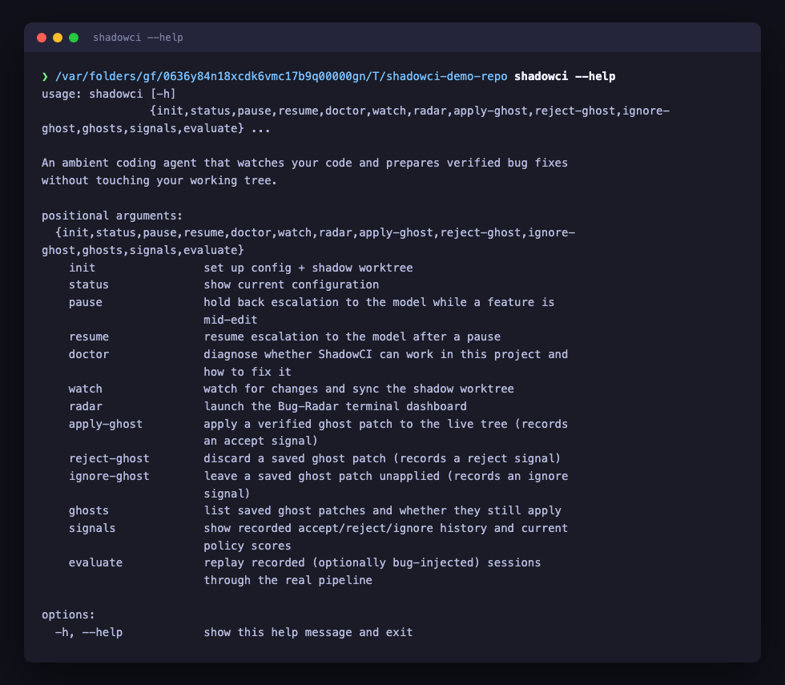

**`shadowci init`** — sets up config and a real git shadow worktree.

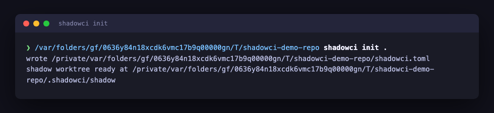

**`shadowci status`** — inspect the active configuration.

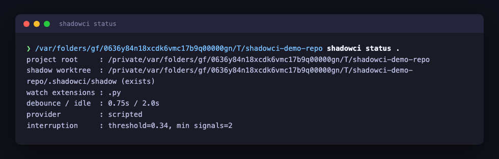

**`shadowci watch`** — detects a file change, waits for it to settle, syncs
it into the shadow worktree, and runs tests/type-checker/linter there —
all clean, so it stays silent.

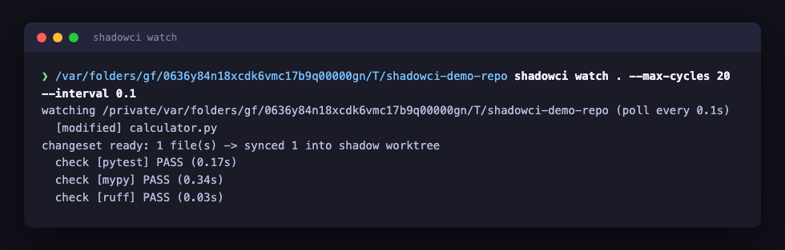

**A real failure escalates** — a targeted test catches the bug, ShadowCI
calls the LLM provider for a regression test and a proposed fix, then tries
to verify that fix for real in the shadow worktree before trusting it (here
the scripted demo provider's placeholder fix doesn't actually apply, so
ShadowCI reports that honestly instead of offering a broken patch).

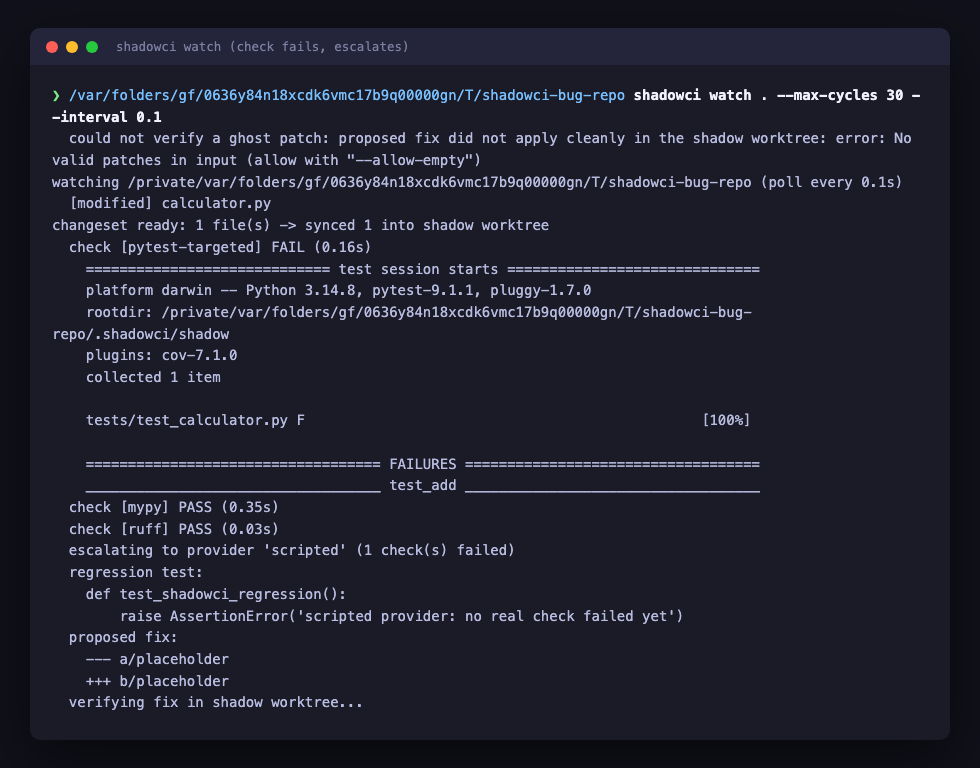

**Failure path** — `shadowci init` against a directory that isn't a git
repository fails cleanly instead of half-initializing.

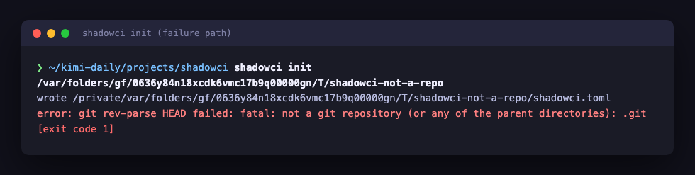

**`shadowci apply-ghost`** — once a fix is verified (regression test
written, fix applied, full suite green, all inside the shadow worktree),
applying it to your real files is one command — and it rebases onto
whatever you've edited in the meantime instead of clobbering it.

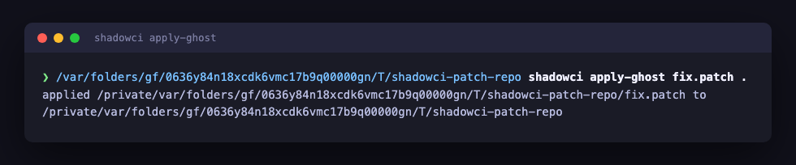

**`shadowci ghosts`** — lists every saved patch with its summary, the files
it touches, and whether it's still `ready` or has gone `stale`, so there's
never a need to go hunting for a patch's hex filename by hand.

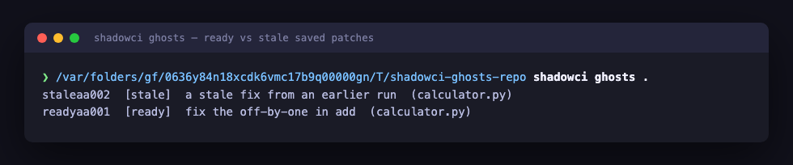

**`shadowci apply-ghost` records an accept signal** — applying a patch is
itself positive feedback: the interruption policy remembers it against the
kind of fix this was (here, a failing targeted test).

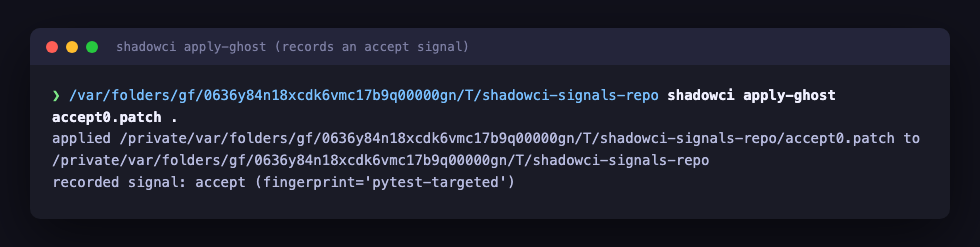

**`shadowci reject-ghost`** — explicitly discarding a patch records a
reject signal and removes it from disk, pulling that kind of fix's score
down.

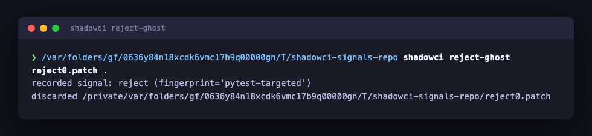

**`shadowci ignore-ghost`** — leaving a patch unapplied records an ignore
signal without deleting it, so a pattern the user never acts on eventually
earns a verdict instead of being inferred as a weak accept.

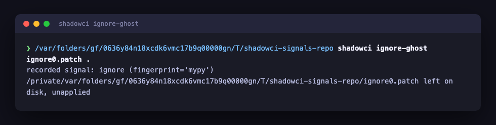

**`shadowci signals`** — the aggregate view: per-fingerprint accept/reject/
ignore counts and the interruption policy's current verdict for each. One
kind of fix has enough accepted history to be surfaced automatically; the
other hasn't been seen enough times yet, so it stays silent.

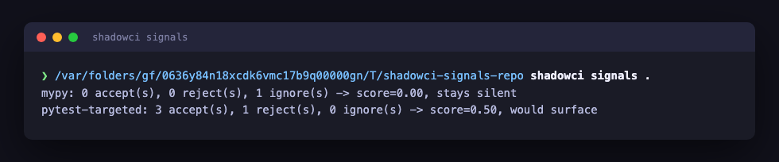

**`shadowci radar`** — the same watch → check → escalate → verify pipeline
as a live terminal dashboard: watched files, check status, and the log, all
in one place, with no pending patches yet.

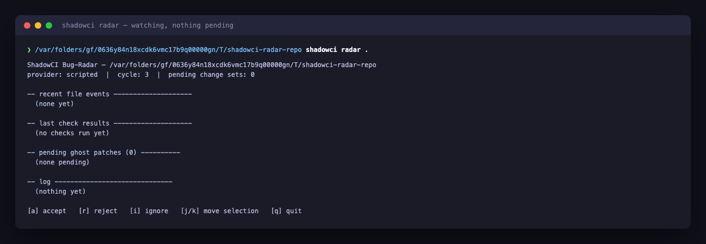

**A ghost patch surfaces on the dashboard** — a real bug lands, the
targeted test fails, the scripted provider's fix verifies, and because this
kind of fix (`unclear-behavior-change:pytest-targeted` — the edited code is
what the failing test covers, and it passed at `HEAD`; see issue #38)
already has an accepted history, the interruption policy marks it
`verdict=surface` instead of staying silent.

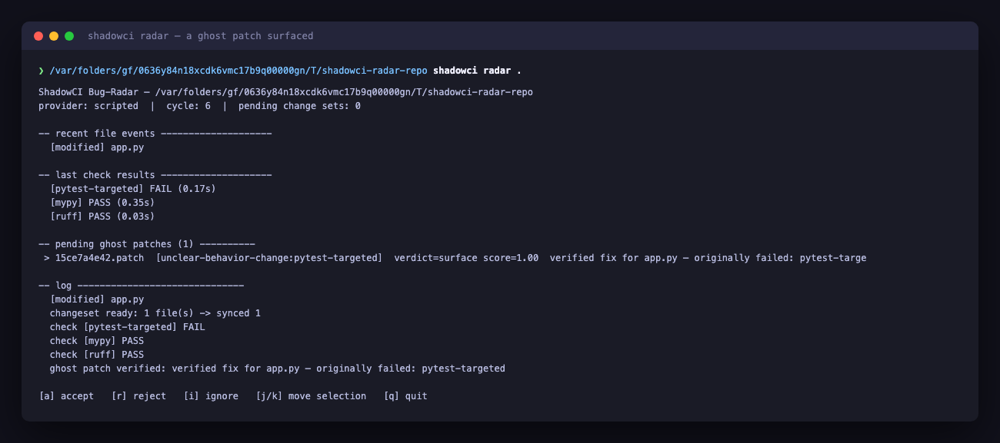

**Accepting it with a keypress** — pressing `a` on the selected patch
applies it to the live tree and records the accept signal through the same
`pipeline.accept_patch` the plain `apply-ghost` command calls; the patch
drops off the pending list immediately.

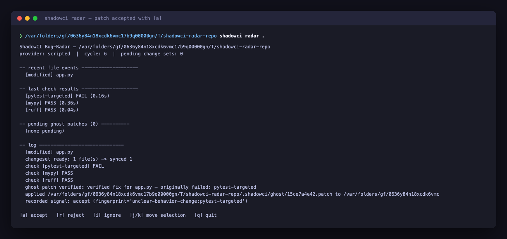

**`shadowci evaluate`** — the evaluation harness replays a built-in suite
of synthetic bug-injected and clean scenarios through the real pipeline on
a simulated clock, with no human in the loop, and reports detection
latency, precision, accept rate, false interruptions, and
`reverted_user_change`.

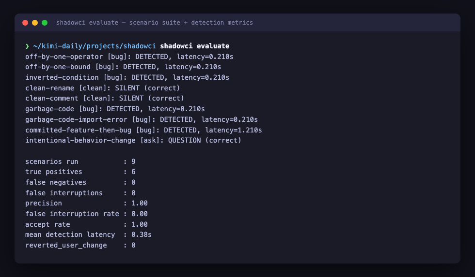

**`shadowci evaluate --repeat`** — replays one bug-and-fix scenario
several times in one project, accepting every verified fix, showing the
interruption policy start silent and converge to surfacing it once its
accept history clears the threshold — the same mechanism behind
`shadowci signals`, demonstrated without a human clicking accept five
times by hand.

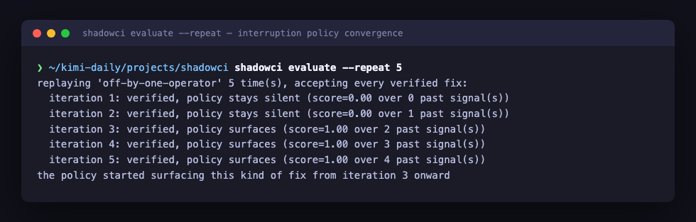

**Test suite** — every module shipped so far is covered.


**`shadowci doctor`** — diagnoses whether ShadowCI can actually work in
this project (git repo, config, shadow worktree, the configured provider,
pytest/mypy/ruff, stale ghost patches) and prints a `Try:` fix for
anything that isn't `OK`; here the project is healthy.

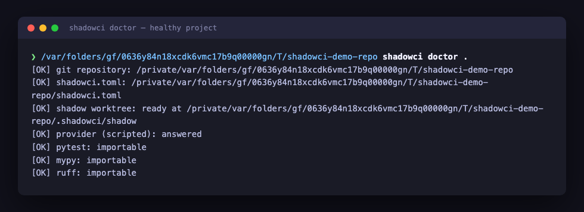

## How It Works

```
                         ┌─────────────────────┐
  live working tree  ──▶ │   FileWatcher        │  save/modify/delete events
  (your editor)          └──────────┬───────────┘
                                     ▼
                         ┌─────────────────────┐
                         │  ChangeSetDetector   │  debounce + idle + syntax
                         │  (never half-typed)  │  check → stable ChangeSet
                         └──────────┬───────────┘
                                     ▼
                         ┌─────────────────────┐
                         │  ShadowWorktree      │  mirrors live file bytes
                         │  (separate git       │  into an isolated git
                         │   worktree)          │  worktree — live tree is
                         └──────────┬───────────┘  never written to
                                     ▼
                         ┌─────────────────────┐
                         │ Deterministic Checks │  tests / type checker /
                         │ (cheap, no LLM cost) │  linters / targeted tests
                         └──────────┬───────────┘
                             pass │   │ fail
                     (stay silent)│   ▼
                                  │ ┌─────────────────────┐
                                  │ │   LLMProvider        │  pluggable:
                                  │ │ (write failing test, │  scripted / claude -p /
                                  │ │  propose fix, verify)│  local model
                                  │ └──────────┬───────────┘
                                  │            ▼
                                  │ ┌─────────────────────┐
                                  │ │   GhostPatch +       │  diff + evidence
                                  │ │   EvidenceCard       │  card, verified in
                                  │ └──────────┬───────────┘  the shadow worktree
                                  │            ▼
                                  │ ┌─────────────────────┐
                                  └▶│ InterruptionPolicy   │  learns from
                                    │ (silence by default) │  accept/reject/ignore
                                    └──────────┬───────────┘
                                                ▼
                                    ┌─────────────────────┐
                                    │  Bug-Radar (TUI) +   │  one-keystroke apply
                                    │  one-keystroke apply │
                                    └─────────────────────┘
```

Separately, `shadowci evaluate` drives the same pipeline as a third
headless caller: it replays recorded (optionally synthetic-bug-injected)
sessions on a simulated clock and scores the result against ground truth
instead of rendering it for a human.

See [PROGRESS.md](PROGRESS.md) for the full design write-up and the module
layout under `src/shadowci/`.

## Development

```bash
pip install -e ".[dev]"
pytest -v
```

The screenshots under `docs/screenshots/` are generated from real command
output (and, for the `radar` dashboard, a real `RadarEngine` run rendered
through the same code the TUI uses) by `scripts/capture_screenshots.py`
(requires `playwright` and a Chromium build:
`pip install playwright && playwright install chromium`).

## Status

ShadowCI's planned feature set is complete and fully tested (190 tests):

- Project scaffold, core data model, file watcher, change-set detector, and
  shadow git worktree.
- Deterministic check runners (pytest, mypy, ruff) with targeted-test
  matching, the `claude-cli` and `local` LLM providers, and an escalation
  policy that calls a provider only after a real check failure.
- Ghost patches: a provider's regression test and fix are verified for
  real in the shadow worktree (test must reproduce the bug, fix must apply
  cleanly, full suite must stay green), then saved as a diff that
  `shadowci apply-ghost` applies to the live tree in one command, rebasing
  onto whatever's changed there since.
- Revert check: before saving a fix, ShadowCI compares it against the
  user's own uncommitted edit (the shadow worktree's `git diff HEAD`). For
  a non-crash failure, a fix that puts that edit back is saved as a
  two-option question (`kind: "question"`, sharing a `group` id) instead
  of a silent fix whenever a matching test rewrite can also be verified;
  `apply-ghost <digest>` applies the chosen option and retires its sibling
  with no signal recorded for it.
- Failure classification (issue #38): before escalating, ShadowCI sorts a
  failure into `regression-elsewhere` (edited code the failing test
  doesn't cover, which passed at `HEAD`), `test-edited` (the user edited
  the failing test itself — the test is the new spec, and a patch may
  never touch it), `unclear-behavior-change` (edited code the test does
  cover, which passed at `HEAD`), or `pre-existing` (the test already
  failed at `HEAD`, so this edit never gets escalated as its cause, and no
  patch is produced).
- Interruption policy: `apply-ghost` / `reject-ghost` / `ignore-ghost`
  record accept/reject/ignore signals grouped by the kind of check that
  originally failed *and* its classification above; a deterministic,
  silent-by-default scoring model decides whether a future fix of that
  kind is worth surfacing, and `shadowci signals` reports the running
  tally and verdict per class — a signals file from before issue #38
  (plain, unprefixed fingerprints) keeps loading alongside new ones.
- `shadowci radar`: a terminal dashboard over the same pipeline, showing
  watched files, live check status, and pending ghost patches with their
  interruption-policy verdict; `a`/`r`/`i` keybindings accept/reject/ignore
  the selected patch through the same logic the plain CLI commands use.
- `shadowci evaluate`: an evaluation harness that replays recorded
  (optionally synthetic-bug-injected) sessions through the real pipeline on
  a simulated clock and reports detection latency, precision, accept rate,
  false interruptions, and `reverted_user_change` (a saved fix that would
  undo an on-purpose user edit) with no human in the loop.
- `shadowci doctor`: diagnoses whether ShadowCI can work in this project
  (git repo, config, shadow worktree, configured provider, pytest/mypy/
  ruff, stale ghost patches), printing `OK`/`WARN`/`FAIL` plus a `Try:` fix
  command for anything that isn't `OK`; `doctor --fix` applies the fixes
  that are always safe without ever touching a source file.

See [PROGRESS.md](PROGRESS.md) for the phase-by-phase build history and
[DAILY_REPORT.md](DAILY_REPORT.md) for a summary of what was built, test
results, known limitations, and ideas for future work.

## License

MIT — see [LICENSE](LICENSE).
