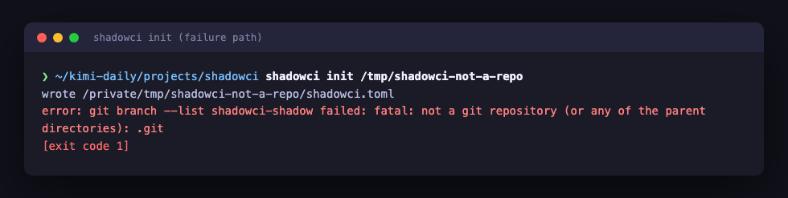
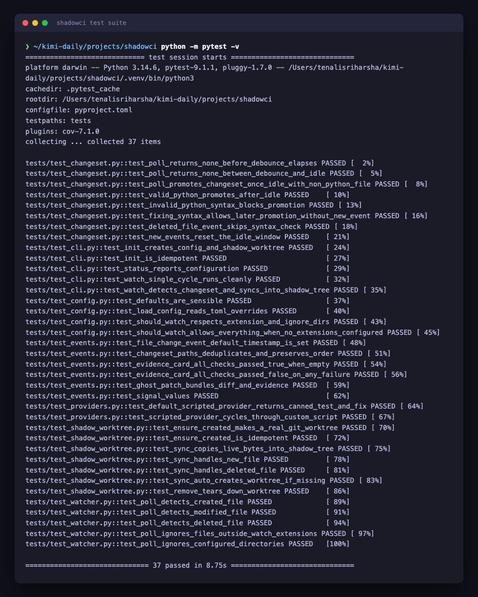

# ShadowCI

[](https://github.com/tenalisriharsha/shadowci/actions/workflows/ci.yml)

ShadowCI is an ambient coding agent that watches your code while you work
and prepares verified bug fixes without ever touching your working tree.

It watches file saves, mirrors your uncommitted changes into a shadow git
worktree, and waits until a change set is actually complete — debounced,
idle, and syntactically valid — before doing anything with it. Deterministic
checks (tests, type checker, linters) run first, for free; an LLM is only
called once a real failure is confirmed. When it finds one, ShadowCI writes
a failing test, fixes the bug in the shadow worktree, confirms nothing else
regressed, and hands you a "ghost patch" with an evidence card — a diff you
can apply to your live files in one keystroke, rebased onto whatever you've
edited meanwhile.

Silence is the default. An interruption policy learns from accept, reject,
and ignore signals so it only surfaces a patch when it's confident. LLM
access is pluggable — a scripted deterministic policy for tests and CI,
headless `claude -p`, or a local model — so the whole system runs and is
fully testable with no paid API key.

## Project Status

ShadowCI is under active development. See [PROGRESS.md](PROGRESS.md) for
the full architecture, the phased build plan, and exactly what's
implemented so far.

## Quick Start

```bash
git clone <repo-url>
cd shadowci
pip install -e ".[dev]"

cd /path/to/your/project   # must be a git repository
shadowci init               # writes shadowci.toml and creates the shadow worktree
shadowci status              # inspect current configuration
shadowci watch                # watch for changes and sync them into the shadow worktree
```

## Preview

**`shadowci --help`** — the command surface.


**`shadowci init`** — sets up config and a real git shadow worktree.


**`shadowci status`** — inspect the active configuration.


**`shadowci watch`** — detects a file change, waits for it to settle, and
syncs it into the shadow worktree without touching the live repo's git
state.


**Failure path** — `shadowci init` against a directory that isn't a git
repository fails cleanly instead of half-initializing.



**Test suite** — every module shipped so far is covered.



## How It Works

```
                         ┌─────────────────────┐
  live working tree  ──▶ │   FileWatcher        │  save/modify/delete events
  (your editor)          └──────────┬───────────┘
                                     ▼
                         ┌─────────────────────┐
                         │  ChangeSetDetector   │  debounce + idle + syntax
                         │  (never half-typed)  │  check → stable ChangeSet
                         └──────────┬───────────┘
                                     ▼
                         ┌─────────────────────┐
                         │  ShadowWorktree      │  mirrors live file bytes
                         │  (separate git       │  into an isolated git
                         │   worktree)          │  worktree — live tree is
                         └──────────┬───────────┘  never written to
                                     ▼
                         ┌─────────────────────┐
                         │ Deterministic Checks │  tests / type checker /
                         │ (cheap, no LLM cost) │  linters / targeted tests
                         └──────────┬───────────┘
                             pass │   │ fail
                     (stay silent)│   ▼
                                  │ ┌─────────────────────┐
                                  │ │   LLMProvider        │  pluggable:
                                  │ │ (write failing test, │  scripted / claude -p /
                                  │ │  propose fix, verify)│  local model
                                  │ └──────────┬───────────┘
                                  │            ▼
                                  │ ┌─────────────────────┐
                                  │ │   GhostPatch +       │  diff + evidence
                                  │ │   EvidenceCard       │  card, rebased onto
                                  │ └──────────┬───────────┘  current live tree
                                  │            ▼
                                  │ ┌─────────────────────┐
                                  └▶│ InterruptionPolicy   │  learns from
                                    │ (silence by default) │  accept/reject/ignore
                                    └──────────┬───────────┘
                                                ▼
                                    ┌─────────────────────┐
                                    │  Bug-Radar (TUI) +   │  one-keystroke apply
                                    │  one-keystroke apply │
                                    └─────────────────────┘
```

See [PROGRESS.md](PROGRESS.md) for the full design write-up and the module
layout under `src/shadowci/`.

## Development

```bash
pip install -e ".[dev]"
pytest -v
```

The screenshots under `docs/screenshots/` are generated from real command
output by `scripts/capture_screenshots.py` (requires `playwright` and a
Chromium build: `pip install playwright && playwright install chromium`).

## Status

- Phase 1 (project scaffold, core data model, file watcher, change-set
  detector, shadow git worktree, pluggable LLM provider interface, CLI) is
  implemented and fully tested.
- Deterministic check runners, LLM-driven ghost patches, the interruption
  policy, the terminal bug-radar view, and the evaluation harness are not
  built yet — see [PROGRESS.md](PROGRESS.md) for the phased plan.

## License

MIT — see [LICENSE](LICENSE).
