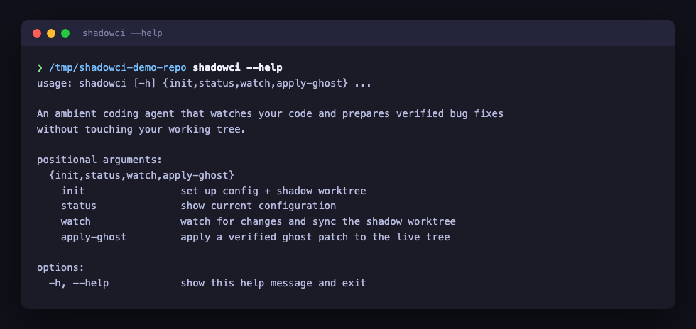
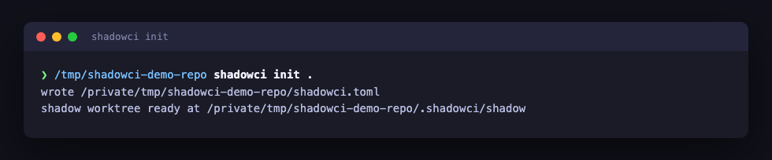
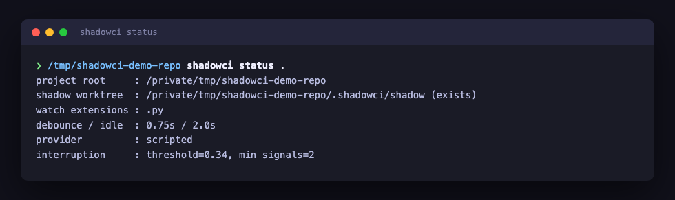
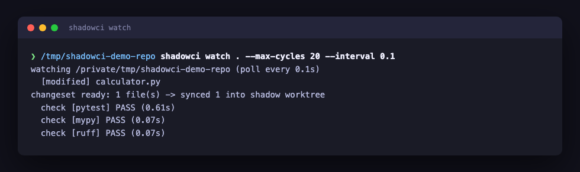
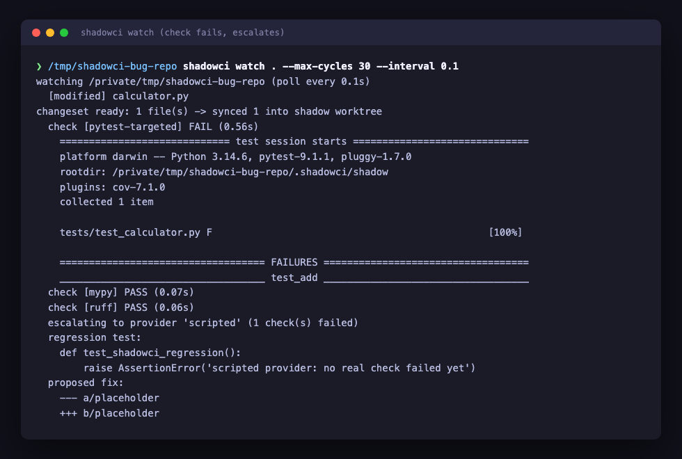
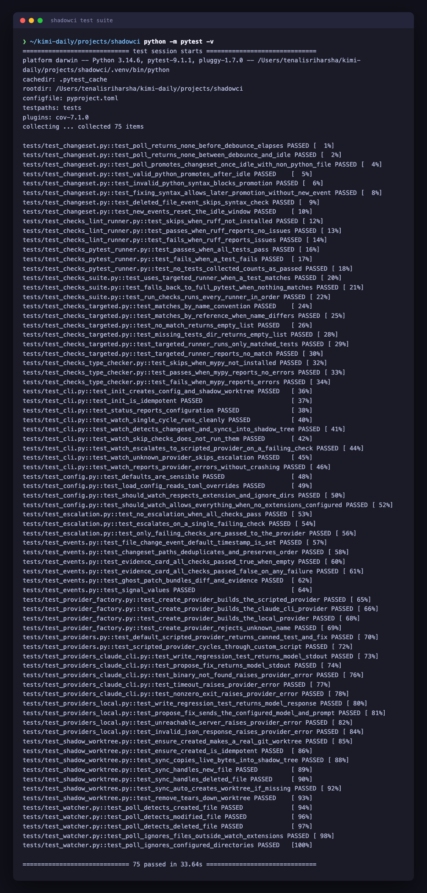

# ShadowCI

[](https://github.com/tenalisriharsha/shadowci/actions/workflows/ci.yml)

ShadowCI is an ambient coding agent that watches your code while you work
and prepares verified bug fixes without ever touching your working tree.

It watches file saves, mirrors your uncommitted changes into a shadow git
worktree, and waits until a change set is actually complete — debounced,
idle, and syntactically valid — before doing anything with it. Deterministic
checks run first, for free: a targeted test run when a changed file maps to
a specific test, falling back to the full suite otherwise, plus a type
checker and a linter (both skipped harmlessly if not installed). An LLM is
only called once one of those checks actually fails — and when it does,
ShadowCI asks it to write a regression test and propose a fix.

LLM access is pluggable — a scripted deterministic policy for tests and CI,
headless `claude -p`, or a local model server (Ollama-compatible) — so the
whole system runs and is fully testable with no paid API key. Turning a
confirmed failure into a verified, rebased "ghost patch" you can apply in
one keystroke is in progress — see [PROGRESS.md](PROGRESS.md).

## Quick Start

```bash
git clone <repo-url>
cd shadowci
pip install -e ".[dev]"

cd /path/to/your/project   # must be a git repository
shadowci init                # writes shadowci.toml and creates the shadow worktree
shadowci status               # inspect current configuration
shadowci watch                 # watch for changes, sync them, run checks, escalate on failure
shadowci watch --skip-checks    # just watch and sync, skip the check/escalation step
```

## Preview

**`shadowci --help`** — the command surface.



**`shadowci init`** — sets up config and a real git shadow worktree.



**`shadowci status`** — inspect the active configuration.



**`shadowci watch`** — detects a file change, waits for it to settle, syncs
it into the shadow worktree, and runs tests/type-checker/linter there —
all clean, so it stays silent.



**A real failure escalates** — a targeted test catches the bug, and only
then does ShadowCI call the LLM provider for a regression test and a
proposed fix.



**Failure path** — `shadowci init` against a directory that isn't a git
repository fails cleanly instead of half-initializing.


**Test suite** — every module shipped so far is covered.



## How It Works

```
                         ┌─────────────────────┐
  live working tree  ──▶ │   FileWatcher        │  save/modify/delete events
  (your editor)          └──────────┬───────────┘
                                     ▼
                         ┌─────────────────────┐
                         │  ChangeSetDetector   │  debounce + idle + syntax
                         │  (never half-typed)  │  check → stable ChangeSet
                         └──────────┬───────────┘
                                     ▼
                         ┌─────────────────────┐
                         │  ShadowWorktree      │  mirrors live file bytes
                         │  (separate git       │  into an isolated git
                         │   worktree)          │  worktree — live tree is
                         └──────────┬───────────┘  never written to
                                     ▼
                         ┌─────────────────────┐
                         │ Deterministic Checks │  tests / type checker /
                         │ (cheap, no LLM cost) │  linters / targeted tests
                         └──────────┬───────────┘
                             pass │   │ fail
                     (stay silent)│   ▼
                                  │ ┌─────────────────────┐
                                  │ │   LLMProvider        │  pluggable:
                                  │ │ (write failing test, │  scripted / claude -p /
                                  │ │  propose fix, verify)│  local model
                                  │ └──────────┬───────────┘
                                  │            ▼
                                  │ ┌─────────────────────┐
                                  │ │   GhostPatch +       │  diff + evidence
                                  │ │   EvidenceCard       │  card, rebased onto
                                  │ └──────────┬───────────┘  current live tree
                                  │            ▼
                                  │ ┌─────────────────────┐
                                  └▶│ InterruptionPolicy   │  learns from
                                    │ (silence by default) │  accept/reject/ignore
                                    └──────────┬───────────┘
                                                ▼
                                    ┌─────────────────────┐
                                    │  Bug-Radar (TUI) +   │  one-keystroke apply
                                    │  one-keystroke apply │
                                    └─────────────────────┘
```

See [PROGRESS.md](PROGRESS.md) for the full design write-up and the module
layout under `src/shadowci/`.

## Development

```bash
pip install -e ".[dev]"
pytest -v
```

The screenshots under `docs/screenshots/` are generated from real command
output by `scripts/capture_screenshots.py` (requires `playwright` and a
Chromium build: `pip install playwright && playwright install chromium`).

## Status

ShadowCI is under active development. Implemented and fully tested so far:

- Project scaffold, core data model, file watcher, change-set detector, and
  shadow git worktree (Phase 1).
- Deterministic check runners (pytest, mypy, ruff) with targeted-test
  matching, the `claude-cli` and `local` LLM providers, and an escalation
  policy that calls a provider only after a real check failure (Phase 2).

Ghost patches, the interruption policy, the terminal bug-radar view, and
the evaluation harness are not built yet — see [PROGRESS.md](PROGRESS.md)
for the full phased plan.

## License

MIT — see [LICENSE](LICENSE).
