# ShadowCI

[](https://github.com/tenalisriharsha/shadowci/actions/workflows/ci.yml)

ShadowCI is an ambient coding agent that watches your code while you work
and prepares verified bug fixes without ever touching your working tree.

It watches file saves, mirrors your uncommitted changes into a shadow git
worktree, and waits until a change set is actually complete — debounced,
idle, and syntactically valid — before doing anything with it. Deterministic
checks run first, for free: a targeted test run when a changed file maps to
a specific test, falling back to the full suite otherwise, plus a type
checker and a linter (both skipped harmlessly if not installed). An LLM is
only called once one of those checks actually fails — and when it does,
ShadowCI asks it to write a regression test and propose a fix.

LLM access is pluggable — a scripted deterministic policy for tests and CI,
headless `claude -p`, or a local model server (Ollama-compatible) — so the
whole system runs and is fully testable with no paid API key. When a check
fails, ShadowCI writes a regression test, applies a proposed fix, and
re-runs the full suite — all inside the shadow worktree. Only once that's
verified does it save a "ghost patch": a diff you can apply to your real
files in one command, `shadowci apply-ghost`, which rebases cleanly onto
whatever you've edited in the meantime instead of clobbering it.

Every verified patch also feeds an interruption policy: `apply-ghost`,
`reject-ghost`, and `ignore-ghost` each record what you actually did with a
fix, grouped by the kind of check that originally failed. With no history
for that kind of fix yet, ShadowCI stays quiet by default — it only
flags a patch as worth surfacing once enough accepted fixes of that kind
show it's wanted. `shadowci signals` shows the running tally and the
policy's current verdict for each kind of fix.

`shadowci radar` puts all of that in one ambient terminal dashboard instead
of a scrolling log: watched files, live check status, and pending ghost
patches with their interruption-policy verdict, each handled with a single
keypress (`a`/`r`/`i`) routed through the exact same accept/reject/ignore
logic as the plain CLI commands.

An evaluation harness (`shadowci evaluate`) replays a suite of recorded
sessions — some with a synthetically injected bug, some clean edits that
should never trigger anything — through that exact same pipeline on a
simulated clock, and reports detection latency, precision, accept rate,
and false interruptions with no human in the loop.

## Quick Start

```bash
git clone <repo-url>
cd shadowci
pip install -e ".[dev]"

cd /path/to/your/project   # must be a git repository
shadowci init                # writes shadowci.toml and creates the shadow worktree
shadowci status               # inspect current configuration
shadowci watch                 # watch for changes, sync them, run checks, escalate on failure
shadowci watch --skip-checks    # just watch and sync, skip the check/escalation step
shadowci radar                   # the same pipeline as a live terminal dashboard
shadowci apply-ghost <patch>       # apply a verified ghost patch to the live tree (records "accept")
shadowci reject-ghost <patch>       # discard a saved patch (records "reject")
shadowci ignore-ghost <patch>        # leave a saved patch unapplied (records "ignore")
shadowci signals                      # show recorded signal history and current policy scores
shadowci evaluate                      # replay the built-in scenario suite and report metrics
```

## Preview

**`shadowci --help`** — the command surface.


**`shadowci init`** — sets up config and a real git shadow worktree.


**`shadowci status`** — inspect the active configuration.


**`shadowci watch`** — detects a file change, waits for it to settle, syncs
it into the shadow worktree, and runs tests/type-checker/linter there —
all clean, so it stays silent.


**A real failure escalates** — a targeted test catches the bug, ShadowCI
calls the LLM provider for a regression test and a proposed fix, then tries
to verify that fix for real in the shadow worktree before trusting it (here
the scripted demo provider's placeholder fix doesn't actually apply, so
ShadowCI reports that honestly instead of offering a broken patch).


**Failure path** — `shadowci init` against a directory that isn't a git
repository fails cleanly instead of half-initializing.


**`shadowci apply-ghost`** — once a fix is verified (regression test
written, fix applied, full suite green, all inside the shadow worktree),
applying it to your real files is one command — and it rebases onto
whatever you've edited in the meantime instead of clobbering it.

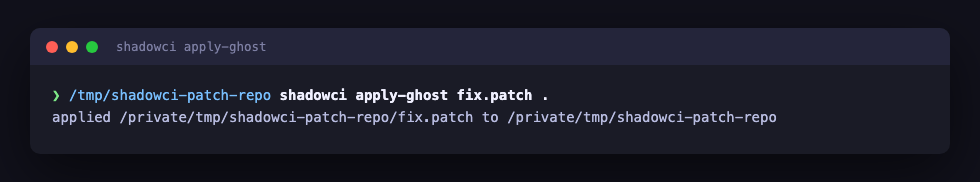

**`shadowci apply-ghost` records an accept signal** — applying a patch is
itself positive feedback: the interruption policy remembers it against the
kind of fix this was (here, a failing targeted test).

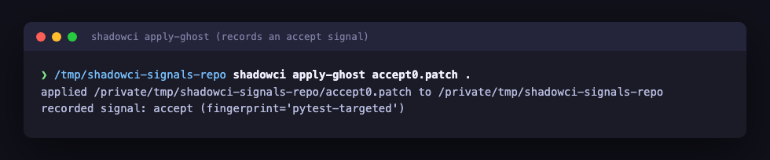

**`shadowci reject-ghost`** — explicitly discarding a patch records a
reject signal and removes it from disk, pulling that kind of fix's score
down.

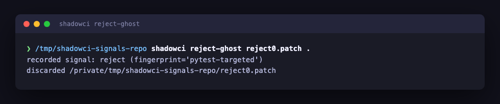

**`shadowci ignore-ghost`** — leaving a patch unapplied records an ignore
signal without deleting it, so a pattern the user never acts on eventually
earns a verdict instead of being inferred as a weak accept.

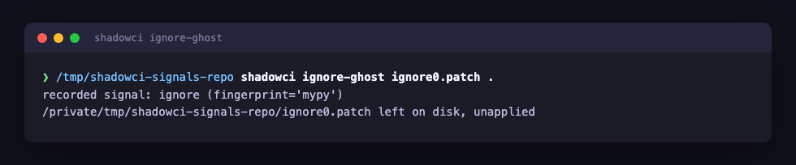

**`shadowci signals`** — the aggregate view: per-fingerprint accept/reject/
ignore counts and the interruption policy's current verdict for each. One
kind of fix has enough accepted history to be surfaced automatically; the
other hasn't been seen enough times yet, so it stays silent.

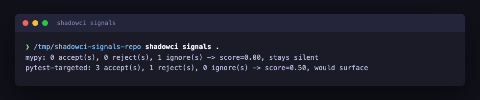

**`shadowci radar`** — the same watch → check → escalate → verify pipeline
as a live terminal dashboard: watched files, check status, and the log, all
in one place, with no pending patches yet.

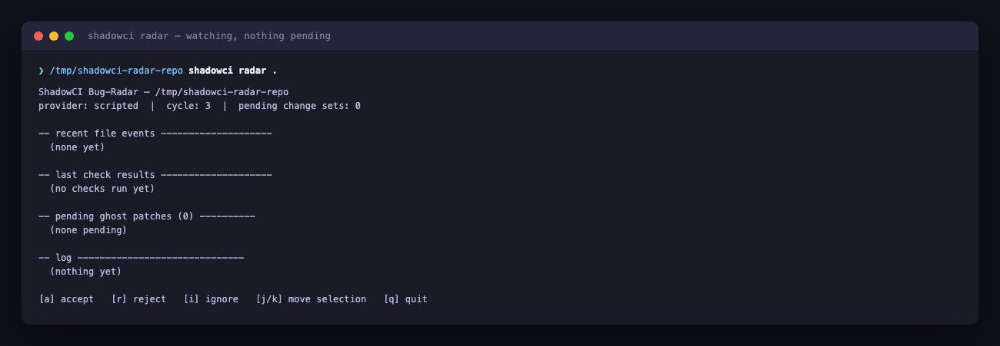

**A ghost patch surfaces on the dashboard** — a real bug lands, the
targeted test fails, the scripted provider's fix verifies, and because this
kind of fix ("pytest-targeted") already has an accepted history, the
interruption policy marks it `verdict=surface` instead of staying silent.

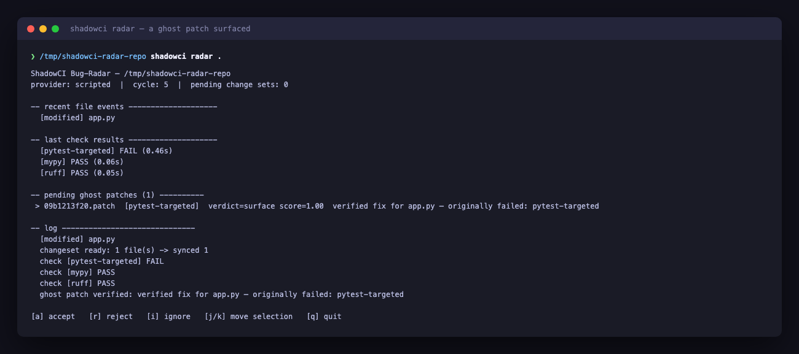

**Accepting it with a keypress** — pressing `a` on the selected patch
applies it to the live tree and records the accept signal through the same
`pipeline.accept_patch` the plain `apply-ghost` command calls; the patch
drops off the pending list immediately.

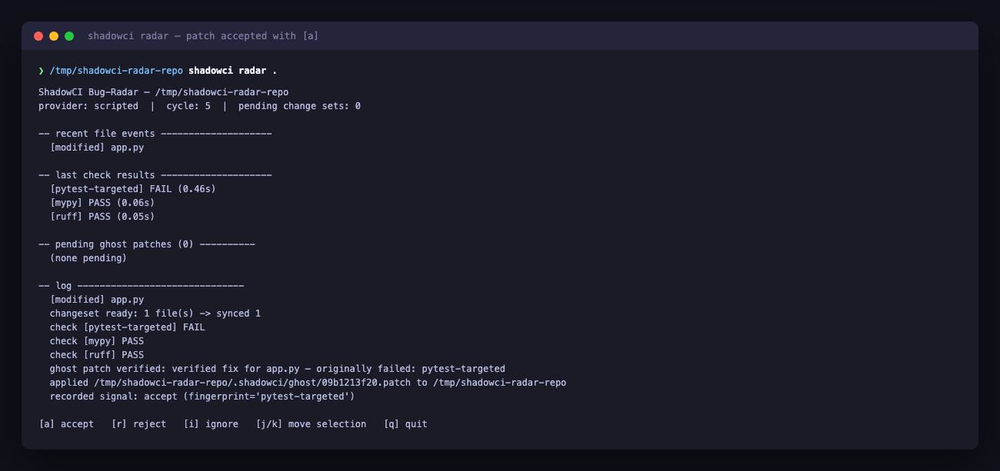

**`shadowci evaluate`** — the evaluation harness replays a built-in suite
of synthetic bug-injected and clean scenarios through the real pipeline on
a simulated clock, with no human in the loop, and reports detection
latency, precision, accept rate, and false interruptions.

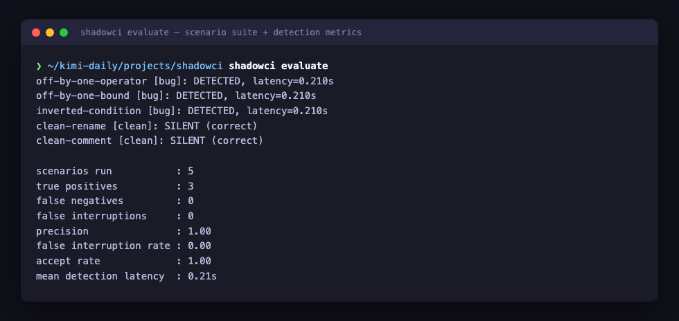

**`shadowci evaluate --repeat`** — replays one bug-and-fix scenario
several times in one project, accepting every verified fix, showing the
interruption policy start silent and converge to surfacing it once its
accept history clears the threshold — the same mechanism behind
`shadowci signals`, demonstrated without a human clicking accept five
times by hand.

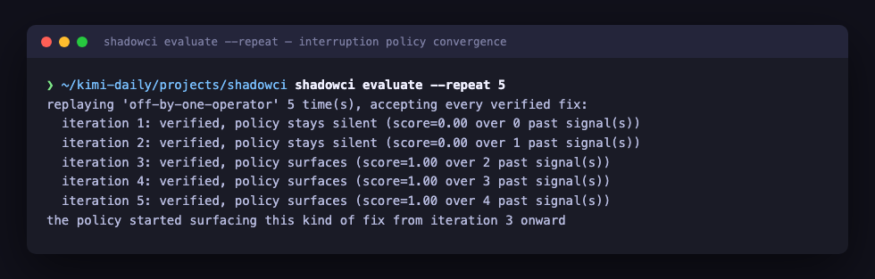

**Test suite** — every module shipped so far is covered.

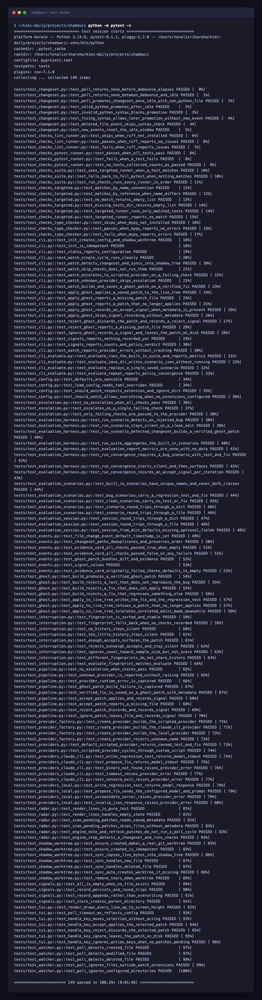

## How It Works

```
                         ┌─────────────────────┐
  live working tree  ──▶ │   FileWatcher        │  save/modify/delete events
  (your editor)          └──────────┬───────────┘
                                     ▼
                         ┌─────────────────────┐
                         │  ChangeSetDetector   │  debounce + idle + syntax
                         │  (never half-typed)  │  check → stable ChangeSet
                         └──────────┬───────────┘
                                     ▼
                         ┌─────────────────────┐
                         │  ShadowWorktree      │  mirrors live file bytes
                         │  (separate git       │  into an isolated git
                         │   worktree)          │  worktree — live tree is
                         └──────────┬───────────┘  never written to
                                     ▼
                         ┌─────────────────────┐
                         │ Deterministic Checks │  tests / type checker /
                         │ (cheap, no LLM cost) │  linters / targeted tests
                         └──────────┬───────────┘
                             pass │   │ fail
                     (stay silent)│   ▼
                                  │ ┌─────────────────────┐
                                  │ │   LLMProvider        │  pluggable:
                                  │ │ (write failing test, │  scripted / claude -p /
                                  │ │  propose fix, verify)│  local model
                                  │ └──────────┬───────────┘
                                  │            ▼
                                  │ ┌─────────────────────┐
                                  │ │   GhostPatch +       │  diff + evidence
                                  │ │   EvidenceCard       │  card, verified in
                                  │ └──────────┬───────────┘  the shadow worktree
                                  │            ▼
                                  │ ┌─────────────────────┐
                                  └▶│ InterruptionPolicy   │  learns from
                                    │ (silence by default) │  accept/reject/ignore
                                    └──────────┬───────────┘
                                                ▼
                                    ┌─────────────────────┐
                                    │  Bug-Radar (TUI) +   │  one-keystroke apply
                                    │  one-keystroke apply │
                                    └─────────────────────┘
```

Separately, `shadowci evaluate` drives the same pipeline as a third
headless caller: it replays recorded (optionally synthetic-bug-injected)
sessions on a simulated clock and scores the result against ground truth
instead of rendering it for a human.

See [PROGRESS.md](PROGRESS.md) for the full design write-up and the module
layout under `src/shadowci/`.

## Development

```bash
pip install -e ".[dev]"
pytest -v
```

The screenshots under `docs/screenshots/` are generated from real command
output (and, for the `radar` dashboard, a real `RadarEngine` run rendered
through the same code the TUI uses) by `scripts/capture_screenshots.py`
(requires `playwright` and a Chromium build:
`pip install playwright && playwright install chromium`).

## Status

ShadowCI's planned feature set is complete and fully tested (149 tests):

- Project scaffold, core data model, file watcher, change-set detector, and
  shadow git worktree.
- Deterministic check runners (pytest, mypy, ruff) with targeted-test
  matching, the `claude-cli` and `local` LLM providers, and an escalation
  policy that calls a provider only after a real check failure.
- Ghost patches: a provider's regression test and fix are verified for
  real in the shadow worktree (test must reproduce the bug, fix must apply
  cleanly, full suite must stay green), then saved as a diff that
  `shadowci apply-ghost` applies to the live tree in one command, rebasing
  onto whatever's changed there since.
- Interruption policy: `apply-ghost` / `reject-ghost` / `ignore-ghost`
  record accept/reject/ignore signals grouped by the kind of check that
  originally failed; a deterministic, silent-by-default scoring model
  decides whether a future fix of that kind is worth surfacing, and
  `shadowci signals` reports the running tally and verdict.
- `shadowci radar`: a terminal dashboard over the same pipeline, showing
  watched files, live check status, and pending ghost patches with their
  interruption-policy verdict; `a`/`r`/`i` keybindings accept/reject/ignore
  the selected patch through the same logic the plain CLI commands use.
- `shadowci evaluate`: an evaluation harness that replays recorded
  (optionally synthetic-bug-injected) sessions through the real pipeline on
  a simulated clock and reports detection latency, precision, accept rate,
  and false interruptions with no human in the loop.

See [PROGRESS.md](PROGRESS.md) for the phase-by-phase build history and
[DAILY_REPORT.md](DAILY_REPORT.md) for a summary of what was built, test
results, known limitations, and ideas for future work.

## License

MIT — see [LICENSE](LICENSE).
